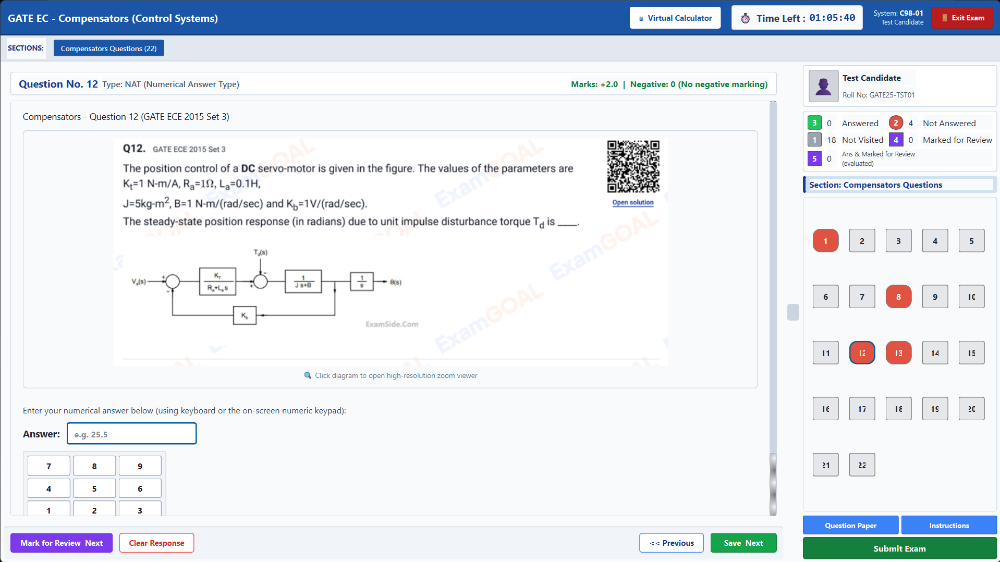
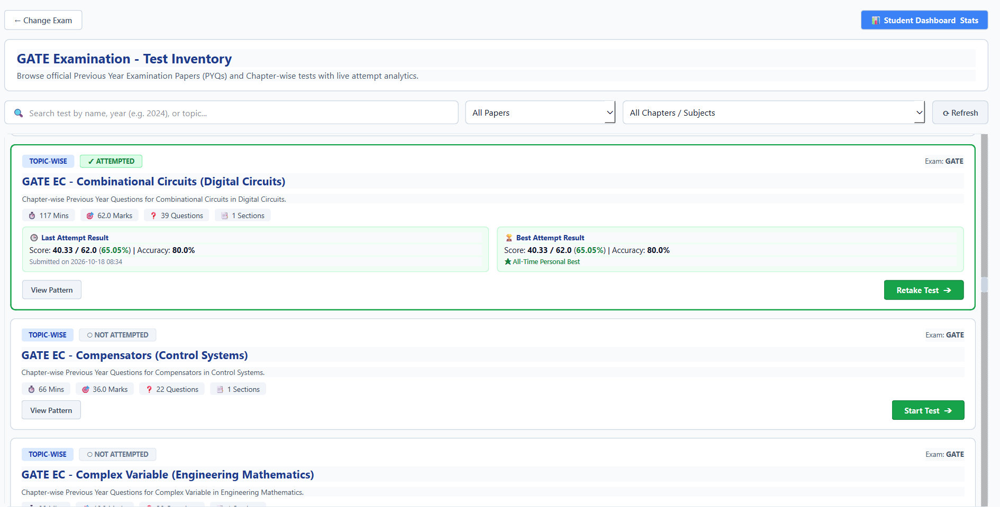
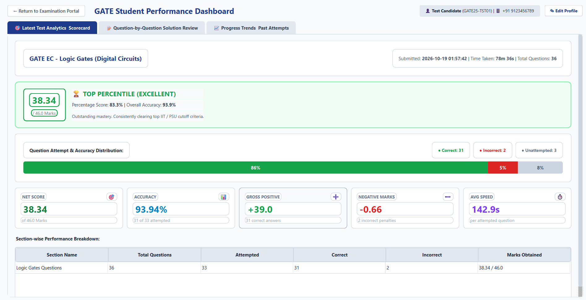
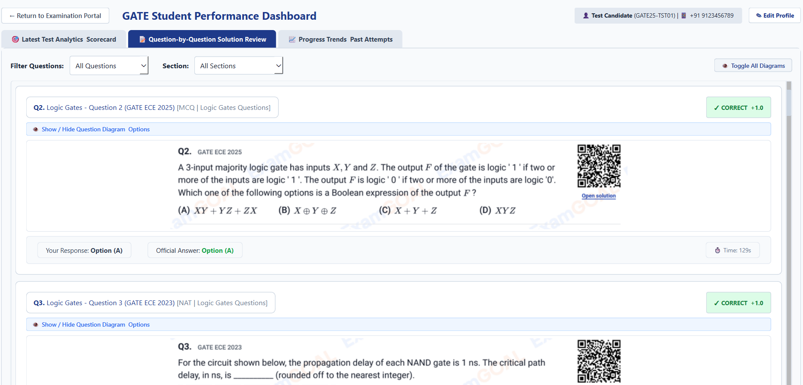
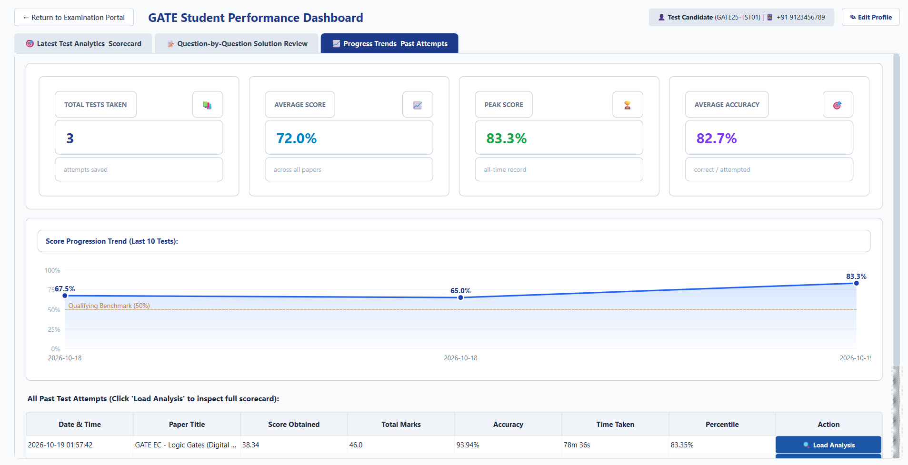

# GATE Computer Based Test (CBT) Series & Exam Engine

A comprehensive desktop Computer-Based Test (CBT) platform modeled after the official TCS iON / GATE examination interface. Built with PyQt6 and Python, providing realistic exam simulation, official proctoring rules, automated evaluation, and rich performance analytics.

---

## 📸 Application Showcase

### 1. Live CBT Examination Interface
Official TCS iON examination layout featuring whole-question high-resolution graphics, interactive Question Palette, live countdown timer, and virtual calculator.


### 2. Test Inventory Browser
Browse all 103 previous year and topic-wise papers with quick chapter/subject filtering, search, and dynamic attempt tracking (Last Attempt & Best Attempt metrics).


### 3. Student Performance Dashboard & Analytics
In-depth post-exam analytics featuring performance tier benchmarks, question accuracy breakdown, gross score, negative penalties, and average speed per question.


### 4. Question-by-Question Solution Review
Comprehensive review of student responses against official answer keys, complete with toggleable high-resolution diagrams and detailed explanations.


### 5. Progress Trends & Historical Attempts
Track all past test attempts, analyze long-term score progression curves, and reload full historical scorecards with a single click.


---

## ✨ Features

- **TCS iON Examination Interface**:
  - Live countdown exam timer with automated submission.
  - Multi-status Question Palette (Answered, Not Answered, Marked for Review, Answered & Marked for Review, Not Visited).
  - Virtual Scientific Calculator adhering to official GATE specifications.
  - Fullscreen Kiosk Mode & Security Manager monitoring window switching.

- **Vast Exam Inventory (103 Total Papers)**:
  - **Full-Length PYQ Papers**: GATE Electronics & Communication (EC) papers from 2000 to 2024.
  - **Topic-Wise Papers**: 72 chapter-wise papers categorized across core subjects (Digital Circuits, Communications, Signals & Systems, Control Systems, Networks, Electronic Devices, Analog Circuits, Electromagnetics, Engineering Mathematics, General Aptitude).
  - High-resolution whole-question image slices preserving complex mathematical formulas, circuits, and diagrams.

- **Strict Question & Evaluation Engine**:
  - Full support for **MCQ** (Multiple Choice Single Correct), **MSQ** (Multiple Select Questions), and **NAT** (Numerical Answer Type).
  - Adherence to standard GATE marking schemes (+1 / +2 positive marks, -0.33 / -0.67 negative penalties, zero penalty for MSQ / NAT).
  - All subjective/conventional questions (> 2 marks) filtered out to ensure 100% CBT compatibility.

- **Student Performance Dashboard**:
  - Visual scorecard with score, accuracy %, percentile, and performance tier.
  - Segmented accuracy breakdown (Correct vs Incorrect vs Unattempted).
  - Interactive question-by-question solution review with toggleable diagram views.
  - Historical attempt tracking and vector-rendered score trend progression.

---

## 🚀 Getting Started

### Prerequisites

- Python 3.10+
- pip

### Installation

1. Clone the repository:
   ```bash
   git clone https://github.com/Rishabh-27-Devloper/TestSeries.git
   cd TestSeries
   ```

2. Install dependencies:
   ```bash
   pip install -r requirements.txt
   ```

3. Launch the application:
   ```bash
   python run_app.py
   ```

---

## 🧪 Running Tests

Run the test suite using pytest:

```bash
pytest tests/ -v
```

---

---

## 🌐 React Web Application (`web/`)

In addition to the PyQt6 desktop client, a modern **React + Vite + TypeScript + Tailwind CSS** deployable web version is included in [`web/`](file:///c:/Users/Anand%20Shukla/Documents/TestSeries/web).

### Web Features:
- **Zero-Config Deployment**: Ready to deploy directly to Vercel, Netlify, or GitHub Pages.
- **TCS iON CBT Experience in Browser**: Live timer, section switching, virtual scientific calculator modal, question palette, and full evaluation engine.
- **LocalStorage Persistence**: Auto-seeds past attempt data and saves new exam scores, question responses, and candidate profiles in the browser.
- **Dual-Tier Asset Delivery**: Seamlessly serves local slices or falls back to CDN/GitHub raw image assets.

### Running the Web Version Locally:
```bash
cd web
npm install
npm run dev
```

### Production Build & Deploy:
```bash
cd web
npm run build
```
The output is generated in `web/dist/`, ready for any static hosting provider. Configuration files for Vercel (`web/vercel.json`) and Netlify (`web/netlify.toml`) are pre-configured with SPA route rewriting.

---

## 📁 Project Structure

```
TestSeries/
├── assets/                  # Original exam PDFs, UI icons, and resources
├── core/                    # Desktop data models, storage manager, evaluation engine
├── data/
│   ├── attempts/            # Saved student attempt scorecards (JSON)
│   ├── papers/              # 103 parsed exam paper definitions and question image slices
│   └── user_profile.json    # Candidate profile settings
├── docs/
│   └── screenshots/         # Application interface screenshots
├── tests/                   # Automated test suites for CBT engine, validation, and GUI
├── tools/                   # Parsing scripts and data extraction utilities
├── ui/                      # PyQt6 application layers, widgets, and dialogs
├── web/                     # React + Vite + TypeScript web application
│   ├── src/                 # React components (Inventory, Exam, Dashboard, Calculator)
│   ├── public/data/         # Standardized paper manifests and JSONs
│   ├── vercel.json          # Vercel deployment configuration
│   └── netlify.toml         # Netlify deployment configuration
├── requirements.txt         # Python project dependencies
└── run_app.py               # Desktop application entry point
```
